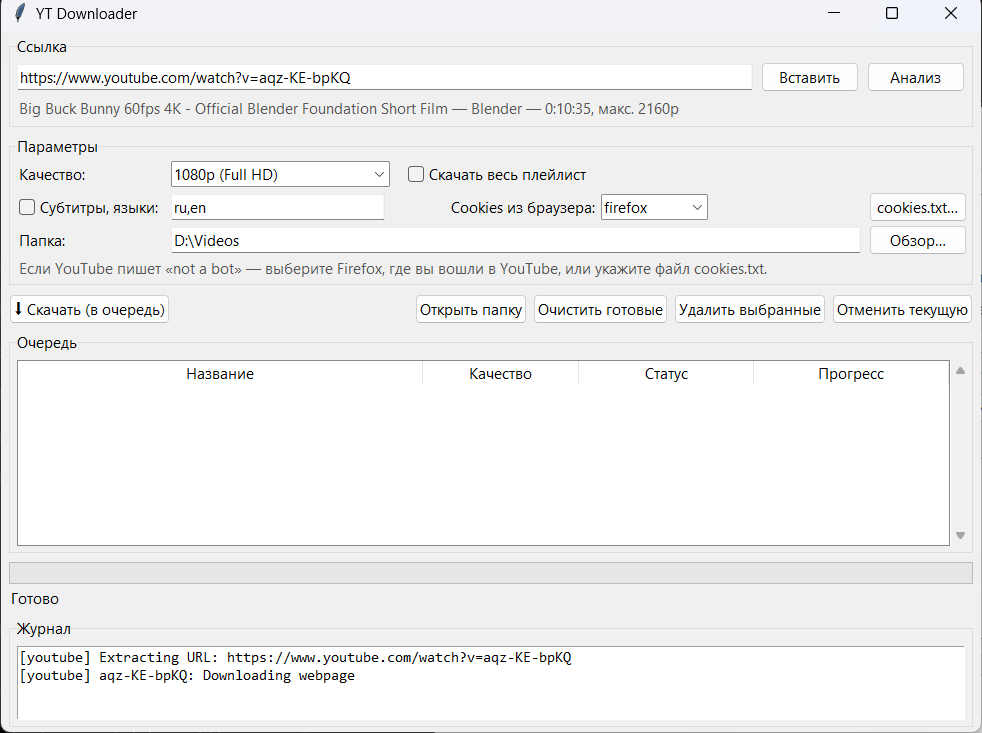
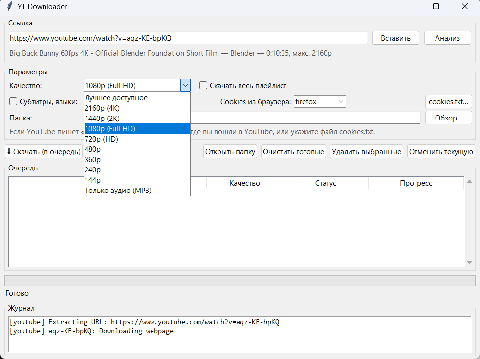
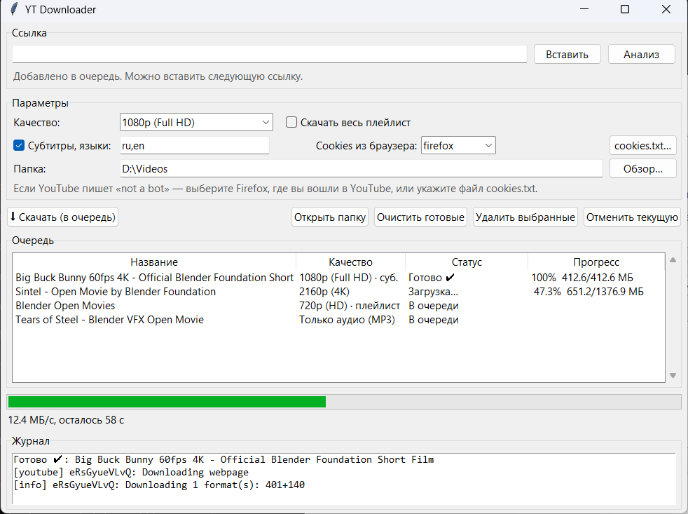

# YT Downloader

**English** | [Русский](README.md)

A simple desktop app for **Windows, Linux and macOS**. It downloads YouTube videos in high quality (up to 4K) **with sound** as MP4, and also handles MP3, playlists and subtitles. It is built on [yt-dlp](https://github.com/yt-dlp/yt-dlp) and ships with ffmpeg, so you don't need to install anything else.



> The interface is in Russian. The table [below](#interface-cheat-sheet) translates every control.

## Features

- **Quality choice.** The list shows only the resolutions the video actually has: 4K, 2K, 1080p, 720p and lower.
- **MP4 with sound.** YouTube serves video and audio as separate streams; the app merges them into one file automatically.
- **Audio only.** MP3 at the best quality, with cover art and title tags.
- **Playlists.** A whole playlist goes into its own folder, with numbered files.
- **Download queue.** Add several links; they download one after another.
- **Subtitles.** Any language, including auto-generated ones. They are embedded in the MP4 and also saved as `.srt` next to it.
- **Progress.** Shows speed and time left, and you can cancel a download.

## Download

Go to [**Releases**](../../releases/latest) and download the file for your system:

| OS | File |
|---|---|
| Windows 10/11 (x64) | `YTDownloader-windows.exe` |
| Linux (x86_64) | `YTDownloader-linux-x86_64.tar.gz` |
| macOS (Apple Silicon, M1 and newer) | `YTDownloader-macos-arm64.zip` |

### Windows

Run `YTDownloader-windows.exe`. No installation is needed.

> SmartScreen may warn about an unknown publisher because the app is not code-signed. Click **More info → Run anyway**.

### Linux

```bash
tar -xzf YTDownloader-linux-x86_64.tar.gz
./YTDownloader
```

The binary is built on Ubuntu 22.04, so it runs on most distros from 2022 onward (glibc 2.35+). It needs a graphical session (X11 or Wayland via XWayland).

### macOS

1. Unzip `YTDownloader-macos-arm64.zip` and move **YTDownloader.app** to **Applications**.
2. The app is not signed with an Apple certificate, so macOS blocks the first launch. To allow it:
   - open the app once, then go to **System Settings → Privacy & Security** and click **Open Anyway**;
   - or run this in Terminal:
     ```bash
     xattr -dr com.apple.quarantine /Applications/YTDownloader.app
     ```

On an Intel Mac, run the app [from source](#run-from-source).

## How to use

1. Copy a video or playlist link, click **«Вставить»** (Paste), then **«Анализ»** (Analyze).
2. Pick a quality from the list.

   

3. If you want, turn on **subtitles** (comma-separated languages such as `en,ru`) or **«Скачать весь плейлист»** (Download whole playlist).
4. Choose a folder and click **«⬇ Скачать (в очередь)»** (Download / add to queue). You can keep adding links while a download is running.

   

5. **«Открыть папку»** (Open folder) shows the downloaded files.

The folder, cookie settings and subtitle languages are remembered between launches.

### Interface cheat sheet

| Russian | English |
|---|---|
| Ссылка / Вставить / Анализ | Link / Paste / Analyze |
| Качество | Quality |
| Лучшее доступное | Best available |
| Только аудио (MP3) | Audio only (MP3) |
| Скачать весь плейлист | Download whole playlist |
| Субтитры, языки | Subtitles, languages |
| Cookies из браузера / Нет | Cookies from browser / None |
| Папка / Обзор… | Folder / Browse… |
| Скачать (в очередь) | Download (add to queue) |
| Открыть папку | Open folder |
| Очистить готовые | Clear finished |
| Удалить выбранные | Remove selected |
| Отменить текущую | Cancel current |
| Очередь / Журнал | Queue / Log |
| В очереди / Загрузка… / Готово / Ошибка / Отменено | Queued / Downloading… / Done / Error / Cancelled |

## "Sign in to confirm you're not a bot"

YouTube sometimes requires you to be signed in, especially when you use a VPN. The app then needs cookies from a browser where you are signed in to YouTube:

- **Firefox (all systems).** Choose `firefox` in **«Cookies из браузера»**. Nothing else is needed.
- **Safari (macOS).** Choose `safari`. macOS may ask you to grant the app Full Disk Access.
- **Chrome, Edge, Brave and other Chromium browsers.** On Linux and macOS you can select them directly; macOS may ask for Keychain access. **On Windows they don't work directly**, because these browsers encrypt cookies in a way other apps cannot read. Install the **"Get cookies.txt LOCALLY"** extension, open youtube.com, click **Export**, and pick the saved file with the **«cookies.txt…»** button.

> ⚠️ A cookies file gives access to your Google account. Never share or publish it. It is safer to use a separate account just for downloading.

## Run from source

You need Python 3.10+ with Tkinter. On Linux, install it with `sudo apt install python3-tk`. With Homebrew on macOS, install it with `brew install python-tk`.

```bash
pip install -r requirements.txt
python yt_downloader.py
```

To build your own binary:

```bash
pip install pyinstaller
build.bat        # Windows
bash build.sh    # Linux / macOS
```

The result appears in `dist/`. Every tag `v*` triggers GitHub Actions, which builds all three versions and publishes a release.

## Notes

- Above 1080p, YouTube usually serves VP9 or AV1. The file is still an MP4 and plays in VLC, browsers, IINA and the Windows 10/11 Films & TV app. If H.264 exists at the chosen resolution, the app prefers it.
- For the full list of formats, yt-dlp needs a JavaScript runtime: [Node.js](https://nodejs.org) or [Deno](https://deno.com). Without one, some formats may be missing.
- If downloads stop working, YouTube has probably changed something. Get the latest release, or update yt-dlp: `pip install -U "yt-dlp[default]"`.
- Only download content you have the right to, and follow YouTube's Terms of Service.
