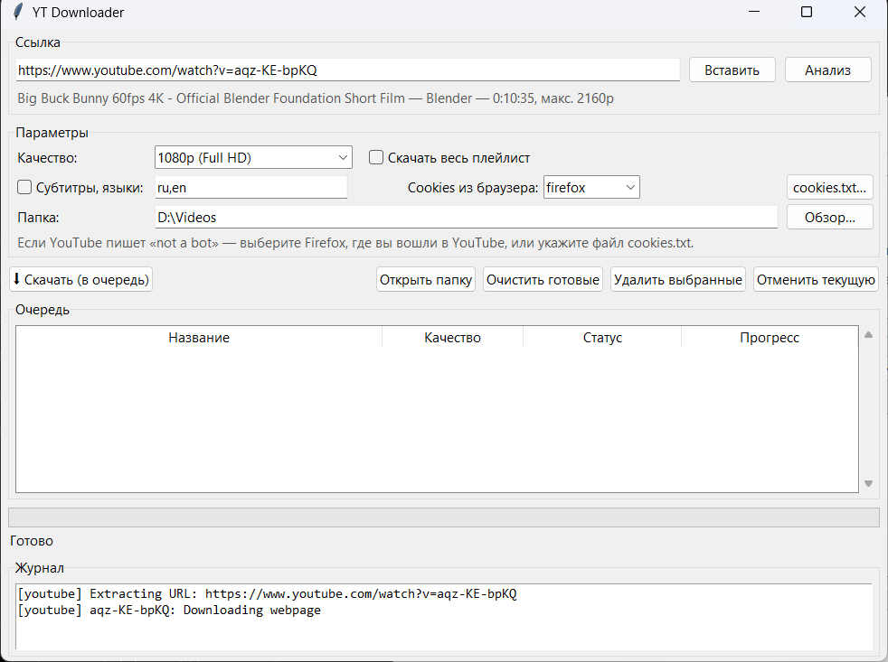
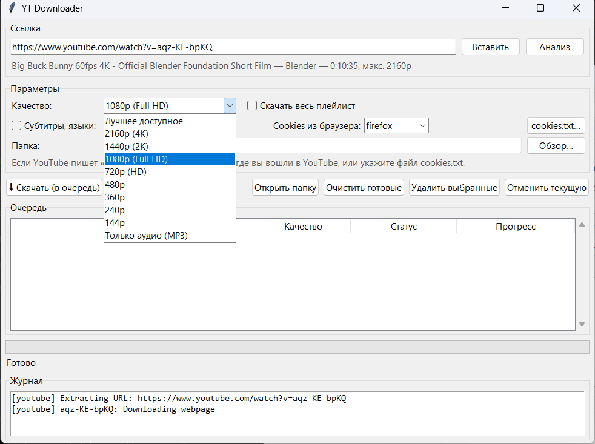
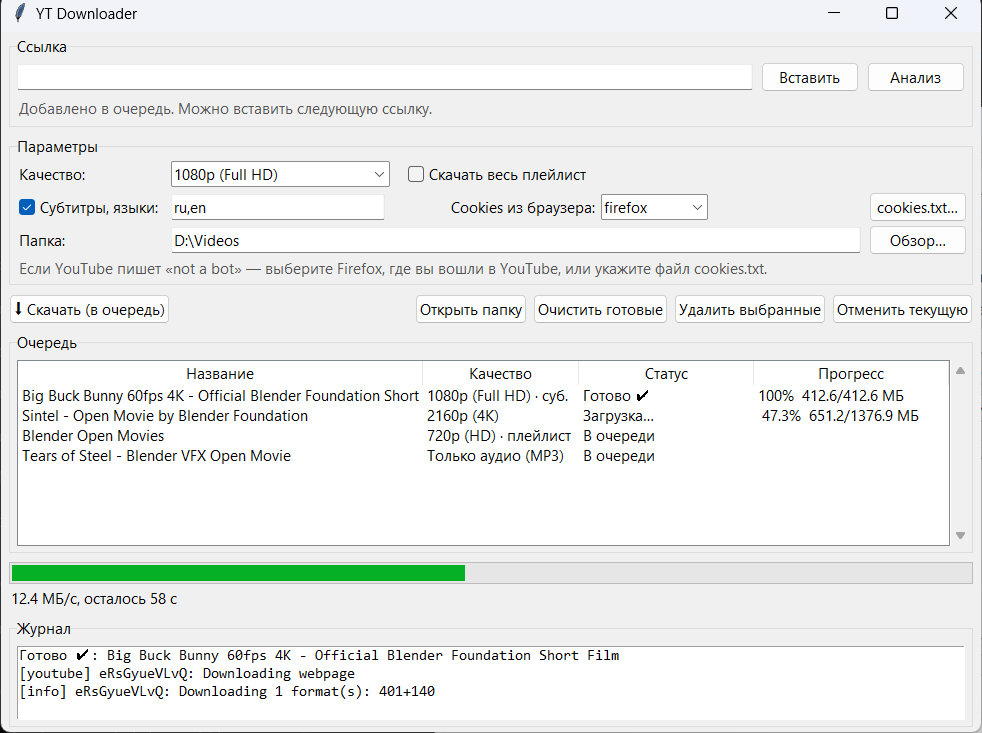

# YT Downloader

[English](README.en.md) | **Русский**

Простая программа для **Windows, Linux и macOS**: скачивает видео с YouTube в хорошем качестве (до 4K) **со звуком** в MP4, а также MP3, плейлисты и субтитры. Внутри работают [yt-dlp](https://github.com/yt-dlp/yt-dlp) и ffmpeg, ставить их отдельно не нужно.



## Возможности

- **Выбор качества.** Программа показывает разрешения, которые реально есть у видео: 4K, 2K, 1080p, 720p и ниже.
- **MP4 со звуком.** YouTube отдаёт картинку и звук отдельно, программа сама склеивает их в один файл.
- **Только аудио.** MP3 в лучшем качестве, с обложкой и названием.
- **Плейлисты.** Весь плейлист скачивается в отдельную папку, файлы пронумерованы.
- **Очередь загрузок.** Можно добавить сразу несколько ссылок, они скачаются по очереди.
- **Субтитры.** Любые языки, в том числе автоматические. Встраиваются в MP4, а `.srt` сохраняется рядом.
- **Прогресс.** Видно скорость и оставшееся время, загрузку можно отменить.

## Скачать

Откройте раздел [**Releases**](../../releases/latest) и скачайте файл для своей системы:

| Система | Файл |
|---|---|
| Windows 10/11 (x64) | `YTDownloader-windows.exe` |
| Linux (x86_64) | `YTDownloader-linux-x86_64.tar.gz` |
| macOS (Apple Silicon, M1 и новее) | `YTDownloader-macos-arm64.zip` |

### Windows

Запустите `YTDownloader-windows.exe`. Установка не нужна.

> Windows SmartScreen может предупредить о неизвестном издателе: программа не подписана сертификатом. Нажмите **«Подробнее» → «Выполнить в любом случае»**.

### Linux

```bash
tar -xzf YTDownloader-linux-x86_64.tar.gz
./YTDownloader
```

Файл собран на Ubuntu 22.04 и запускается на большинстве дистрибутивов с 2022 года (glibc 2.35+). Нужен графический сеанс: X11 или Wayland через XWayland.

### macOS

1. Распакуйте `YTDownloader-macos-arm64.zip` и перенесите **YTDownloader.app** в **Программы**.
2. Приложение не подписано сертификатом Apple, поэтому при первом запуске macOS его заблокирует. Чтобы разрешить запуск:
   - один раз попробуйте открыть приложение, затем зайдите в **Системные настройки → Конфиденциальность и безопасность** и нажмите **«Всё равно открыть»**;
   - или выполните в Терминале:
     ```bash
     xattr -dr com.apple.quarantine /Applications/YTDownloader.app
     ```

На Mac с процессором Intel запускайте программу [из исходников](#запуск-из-исходников).

## Как пользоваться

1. Скопируйте ссылку на видео или плейлист, нажмите **«Вставить»**, затем **«Анализ»**.
2. Выберите качество в списке.

   

3. При желании включите **субтитры** (языки через запятую, например `ru,en`) или **«Скачать весь плейлист»**.
4. Укажите папку и нажмите **«⬇ Скачать (в очередь)»**. Пока идёт загрузка, можно добавлять следующие ссылки.

   

5. Кнопка **«Открыть папку»** покажет скачанные файлы.

Папка, настройки cookies и языки субтитров запоминаются между запусками.

## Ошибка «Sign in to confirm you're not a bot»

YouTube иногда просит войти в аккаунт, особенно при работе через VPN. Программе нужны cookies браузера, в котором вы вошли в YouTube:

- **Firefox (все системы).** Выберите `firefox` в поле **«Cookies из браузера»**. Больше ничего делать не нужно.
- **Safari (macOS).** Выберите `safari`. macOS может попросить дать программе «Полный доступ к диску».
- **Chrome, Edge, Brave и другие браузеры на Chromium.** На Linux и macOS их можно выбрать в списке, macOS может спросить доступ к связке ключей. **На Windows напрямую они не работают**: браузеры шифруют cookies так, что другие программы не могут их прочитать. Поставьте расширение **«Get cookies.txt LOCALLY»**, откройте youtube.com, нажмите **Export** и укажите сохранённый файл кнопкой **«cookies.txt…»**.

> ⚠️ Файл cookies даёт доступ к вашему Google-аккаунту. Никому его не передавайте и не выкладывайте. Безопаснее использовать отдельный аккаунт только для скачивания.

## Запуск из исходников

Нужен Python 3.10+ с Tkinter. На Linux он ставится командой `sudo apt install python3-tk`, на macOS через Homebrew командой `brew install python-tk`.

```bash
pip install -r requirements.txt
python yt_downloader.py
```

Собрать свой исполняемый файл:

```bash
pip install pyinstaller
build.bat        # Windows
bash build.sh    # Linux / macOS
```

Результат появится в папке `dist/`. На каждый тег `v*` GitHub Actions сам собирает все три версии и публикует релиз.

## Заметки

- Видео выше 1080p YouTube обычно отдаёт в кодеках VP9 или AV1. Файл всё равно будет MP4, его откроют VLC, браузеры, IINA и «Кино и ТВ» в Windows 10/11. Если у видео есть H.264 нужного разрешения, программа выбирает его.
- Для полного списка форматов yt-dlp использует JavaScript-движок: [Node.js](https://nodejs.org) или [Deno](https://deno.com). Если ни одного нет, часть форматов может быть недоступна.
- Если программа перестала качать, скорее всего YouTube что-то поменял. Скачайте свежий релиз или обновите yt-dlp: `pip install -U "yt-dlp[default]"`.
- Скачивайте только то, на что у вас есть права, и соблюдайте правила YouTube.
